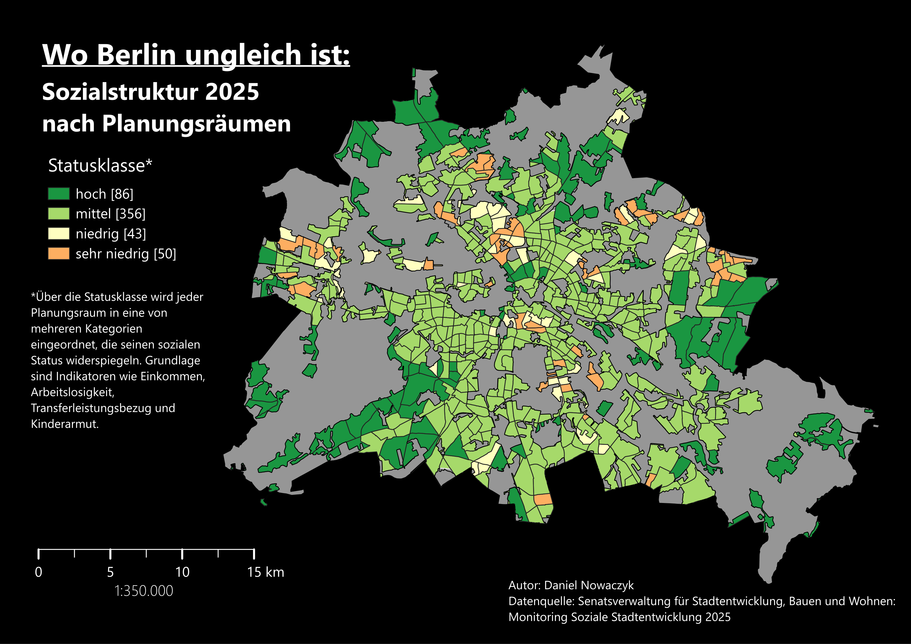
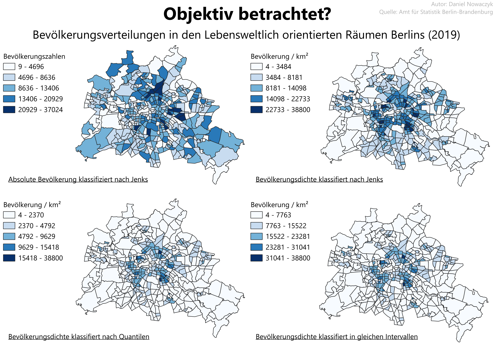
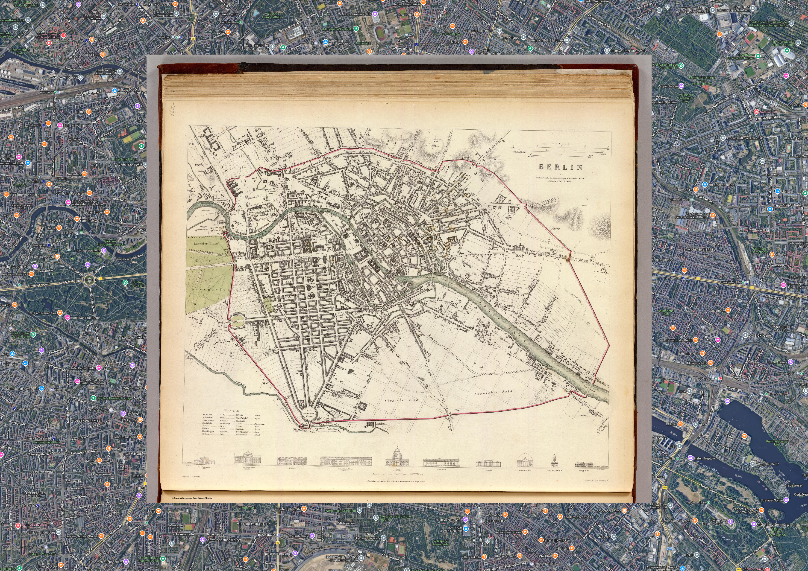
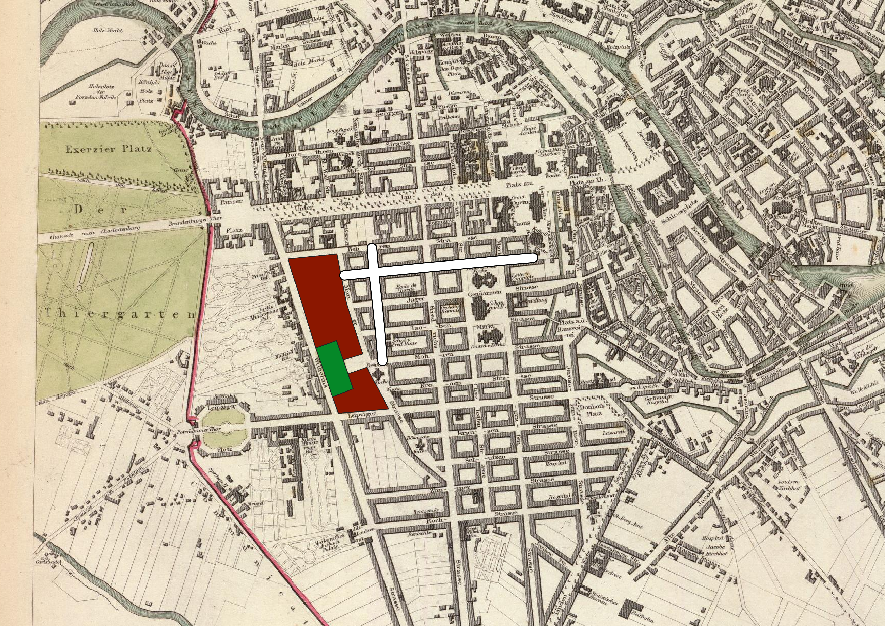

# EP1
## UE 1 Einführung in QGIS
Die Einführung wurde am Beispiel der Sozialstrukturen in Berlin durchgeführt.

##  UE 2 Datenklassifikation
Hier haben wir die unterschiedlichen Berechnungen für Einwohnerzahlen kennengelernt. Dies wurde wieder am Beispiel von Berlin durchgeführt.

# UE 3 Georeferenzieren
In dieser Übung haben wir gelernt, wie man Karten anhand der Berlinkarte von 1833 georeferenziert. 

# UE 4 Digitalisieren
Das digitalisieren der Daten auf der georeferenzierten Karte haben wir in dieser Übung gelernt

